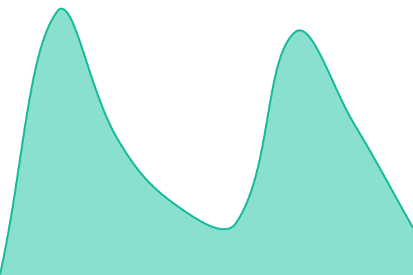
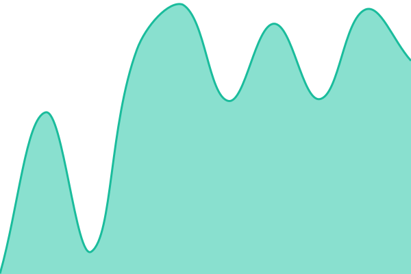

# [📈 Live Status](https://status.vitalang.net): <!--live status--> **🟧 Partial outage**

This repository contains the open-source uptime monitor and status page for [vitalangfoundation](https://status.vitalang.net), powered by [Upptime](https://github.com/upptime/upptime).

With [Upptime](https://upptime.js.org), you can get your own unlimited and free uptime monitor and status page, powered entirely by a GitHub repository. We use [Issues](https://github.com/vitalangfoundation/upptime/issues) as incident reports, [Actions](https://github.com/vitalangfoundation/upptime/actions) as uptime monitors, and [Pages](https://status.vitalang.net) for the status page.

<!--start: status pages-->
<!-- This summary is generated by Upptime (https://github.com/upptime/upptime) -->
<!-- Do not edit this manually, your changes will be overwritten -->
<!-- prettier-ignore -->
| URL | Status | History | Response Time | Uptime |
| --- | ------ | ------- | ------------- | ------ |
|  [VitaLang Website](https://www.vitalang.net) | 🟩 Up | [vita-lang-website.yml](https://github.com/vitalangfoundation/Upptime/commits/HEAD/history/vita-lang-website.yml) | 

 389ms
     
 | 

<a href="https://status.vitalang.net/history/vita-lang-website">100.00%</a>
    

|  [Matrix Server](https://sweetmessaging.vitalang.net) | 🟩 Up | [matrix-server.yml](https://github.com/vitalangfoundation/Upptime/commits/HEAD/history/matrix-server.yml) | 

 392ms
     
 | 

<a href="https://status.vitalang.net/history/matrix-server">100.00%</a>
    

|  Vaultwarden | 🟩 Up | [vaultwarden.yml](https://github.com/vitalangfoundation/Upptime/commits/HEAD/history/vaultwarden.yml) | 

 495ms
     
 | 

<a href="https://status.vitalang.net/history/vaultwarden">100.00%</a>
    

|  [Office Sweet](https://officesweet.vitalang.net/ajax/login) | 🟥 Down | [office-sweet.yml](https://github.com/vitalangfoundation/Upptime/commits/HEAD/history/office-sweet.yml) | 

 367ms
     
 | 

<a href="https://status.vitalang.net/history/office-sweet">0.00%</a>
    

|  [Euler Club Site](https://euler.vitalang.net) | 🟥 Down | [euler-club-site.yml](https://github.com/vitalangfoundation/Upptime/commits/HEAD/history/euler-club-site.yml) | 

 436ms
     
 | 

<a href="https://status.vitalang.net/history/euler-club-site">77.02%</a>
    

|  Email Service Part 1 | 🟩 Up | [email-service-part-1.yml](https://github.com/vitalangfoundation/Upptime/commits/HEAD/history/email-service-part-1.yml) | 

 324ms
     
 | 

<a href="https://status.vitalang.net/history/email-service-part-1">100.00%</a>
    

|  Email Service Part 2 | 🟩 Up | [email-service-part-2.yml](https://github.com/vitalangfoundation/Upptime/commits/HEAD/history/email-service-part-2.yml) | 

 493ms
     
 | 

<a href="https://status.vitalang.net/history/email-service-part-2">100.00%</a>
    

|  Main Proxy | 🟩 Up | [main-proxy.yml](https://github.com/vitalangfoundation/Upptime/commits/HEAD/history/main-proxy.yml) | 

 358ms
     
 | 

<a href="https://status.vitalang.net/history/main-proxy">100.00%</a>
    

|  Private Proxy | 🟩 Up | [private-proxy.yml](https://github.com/vitalangfoundation/Upptime/commits/HEAD/history/private-proxy.yml) | 

 429ms
     
 | 

<a href="https://status.vitalang.net/history/private-proxy">100.00%</a>
    

|  NAS 1 | 🟩 Up | [nas-1.yml](https://github.com/vitalangfoundation/Upptime/commits/HEAD/history/nas-1.yml) | 

 513ms
     
 | 

<a href="https://status.vitalang.net/history/nas-1">100.00%</a>
    

<!--end: status pages-->

[**Visit our status website →**](https://status.vitalang.net)

## 📄 License

- Powered by: [Upptime](https://github.com/upptime/upptime)
- Code: [MIT](./LICENSE) © [Anand Chowdhary](https://anandchowdhary.com)
- Data in the `./history` directory: [Open Database License](https://opendatacommons.org/licenses/odbl/1-0/)
